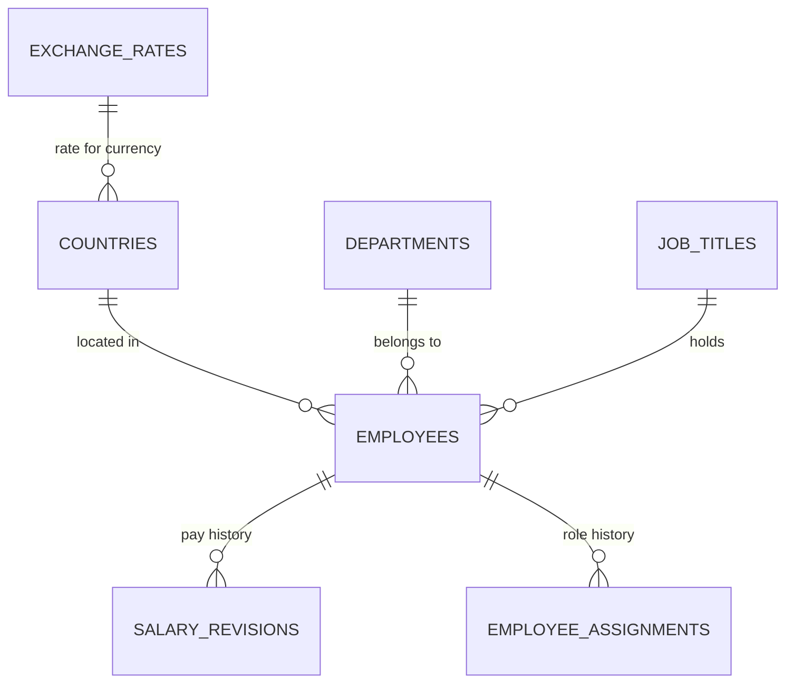

# Architecture

How the system described in [requirements.md](requirements.md) is built, and why.

## Overview

One repository containing two applications:

- `backend/` — Rails 8 JSON API with PostgreSQL
- `frontend/` — React + TypeScript (Vite)

In production, Rails serves the built React app, so the UI and API share one
origin and one deployment.

## Tech stack

| Layer | Choice | Why |
|---|---|---|
| Backend | Rails 8 (API mode) | Role requirement; fast to build a well-structured JSON API |
| Database | PostgreSQL | `percentile_cont` gives an exact median in SQL; SQLite has no median function |
| Frontend | React + TypeScript + Vite | Role requirement; TypeScript catches API contract mismatches early |
| UI components | Ant Design | Its Table supports server-side pagination, sorting and filtering out of the box |
| Data fetching | TanStack Query | Caching, loading and error states without hand-written boilerplate |
| Backend tests | RSpec, FactoryBot | Readable specs; factories keep test data explicit |
| Frontend tests | Vitest, React Testing Library | Fast, and tests behaviour rather than implementation |

## Key decisions

### 1. One repository, one deployment

The brief asks for a single repository link, and commits should show how the
solution evolved. Keeping both apps in one repo means:

- One commit history shows backend and UI changes side by side.
- An API change and the matching UI change land in the same commit.
- Rails serves the React build from the same origin, so authentication can use
  an httpOnly session cookie. Separate deployments would be cross-site and need
  CORS plus `SameSite=None` cookies, or tokens in localStorage, which any XSS bug
  can steal. For salary data, the cookie is the safer choice.
- One service to deploy and demo.

Separate repos would make sense with separate teams, independent release cycles
or multiple clients sharing the API. None apply here, and because the apps
already live in separate folders, splitting them later is straightforward.

### 2. Salaries stay in local currency

Each salary is stored in the employee's country currency. Statistics are
computed per country, because averaging INR and USD values is meaningless.
Org-wide totals are converted to USD using a fixed, dated exchange-rate table,
and every converted figure is labelled as converted.

### 3. History is append-only

Salary revisions and employee assignments (country, department, job title) are
never updated or deleted. Mistakes are corrected with a new entry, so the audit
trail stays trustworthy. Enforced in the models with `readonly?` once a row is
saved, and covered by specs.

### 4. Current values are copied onto the employee

`employees` holds the current salary, country, department and job title. Search,
filtering and insights read one table instead of finding the latest history row
per employee. A history entry and the employee update are saved in one
transaction, so the two never disagree.

### 5. Effective-date rule

A new revision's effective date can't be in the future, or earlier than the
employee's latest revision. The newest revision is therefore always the current
one. Future-dated raises are out of scope.

### 6. Money and consistency

- Money is stored as `decimal(15,2)` with an ISO currency code, never as floats.
- Employees use optimistic locking (`lock_version`): an edit based on stale data
  is rejected instead of silently overwriting someone else's change.

## Data model

| Table | Purpose |
|---|---|
| `countries` | Country code, name and currency code |
| `departments`, `job_titles` | Lookup tables |
| `employees` | Identity plus current salary, currency and assignment |
| `salary_revisions` | Append-only pay history with effective date and reason |
| `employee_assignments` | Append-only history of country, department and job title changes |
| `exchange_rates` | Fixed rates to USD with an "as of" date |

Indexes cover every foreign key, `employee_code`, `email`,
`(country_id, department_id)` for drill-downs, and `(employee_id, effective_date)`
on both history tables.

`readonly?` and an overridden `delete` stop the model from updating or removing a
saved row. Bulk methods (`update_all`, `delete_all`) and raw SQL bypass model
code; nothing in the app calls them, and only the app writes to the database.
A Postgres trigger would close that gap fully, but Rails' schema.rb can't
represent triggers, so it would mean switching to structure.sql. That is the
upgrade path if other systems ever write to this database.