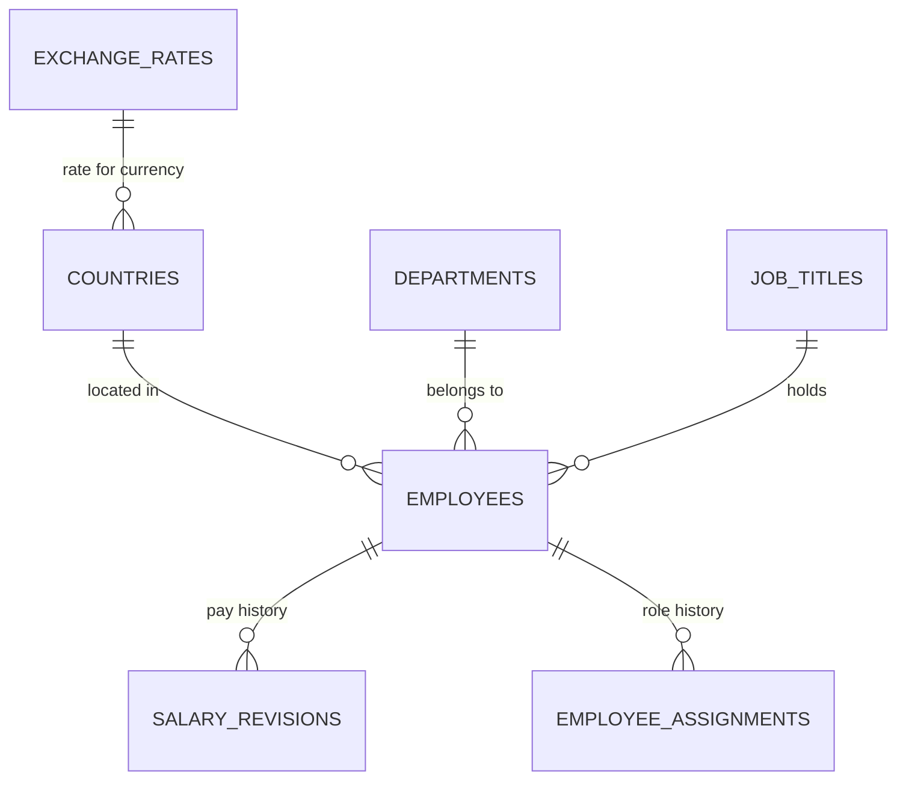

# Architecture

How the system described in [requirements.md](requirements.md) is built, and why.

## Overview

One repository containing two applications:

- `backend/` — Rails 8 JSON API with PostgreSQL
- `frontend/` — React + TypeScript (Vite)

In production, Rails serves the built React app, so the UI and API share one
origin and one deployment.

## Tech stack

| Layer | Choice | Why |
|---|---|---|
| Backend | Rails 8 (API mode) | Role requirement; fast to build a well-structured JSON API |
| Database | PostgreSQL | `percentile_cont` gives an exact median in SQL; SQLite has no median function |
| Frontend | React + TypeScript + Vite | Role requirement; TypeScript catches API contract mismatches early |
| UI components | Ant Design | Its Table supports server-side pagination, sorting and filtering out of the box |
| Data fetching | TanStack Query | Caching, loading and error states without hand-written boilerplate |
| Backend tests | RSpec, FactoryBot | Readable specs; factories keep test data explicit |
| Frontend tests | Vitest, React Testing Library | Fast, and tests behaviour rather than implementation |
| Deployment | Docker on Railway | One image serves API and UI; managed PostgreSQL |

## Key decisions

### 1. One repository, one deployment

The brief asks for a single repository link, and commits should show how the
solution evolved. Keeping both apps in one repo means:

- One commit history shows backend and UI changes side by side.
- An API change and the matching UI change land in the same commit.
- Rails serves the React build from the same origin, so authentication can use
  an httpOnly session cookie. Separate deployments would be cross-site and need
  CORS plus `SameSite=None` cookies, or tokens in localStorage, which any XSS bug
  can steal. For salary data, the cookie is the safer choice.
- One service to deploy and demo.

Separate repos would make sense with separate teams, independent release cycles
or multiple clients sharing the API. None apply here, and because the apps
already live in separate folders, splitting them later is straightforward.

### 2. Salaries stay in local currency

Each salary is stored in the employee's country currency. Statistics are
computed per country, because averaging INR and USD values is meaningless.
Org-wide totals are converted to USD using a fixed, dated exchange-rate table,
and every converted figure is labelled as converted.

### 3. History is append-only

Salary revisions and employee assignments (country, department, job title) are
never updated or deleted. Mistakes are corrected with a new entry, so the audit
trail stays trustworthy.

`readonly?` and an overridden `delete` stop the model from updating or removing a
saved row, and specs cover both. Bulk methods (`update_all`, `delete_all`) and
raw SQL bypass model code; nothing in the app calls them, and only the app
writes to the database. A Postgres trigger would close that gap fully, but
Rails' schema.rb can't represent triggers, so it would mean switching to
structure.sql. That is the upgrade path if other systems ever write to this
database.

### 4. Current values are copied onto the employee

`employees` holds the current salary, country, department and job title. Search,
filtering and insights read one table instead of finding the latest history row
per employee. A history entry and the employee update are saved in one
transaction, so the two never disagree. Employee codes are generated
automatically on hire, with a retry if two hires collide on the unique index.

### 5. Effective-date rule

A new revision's effective date can't be in the future, or earlier than the
employee's latest revision. The newest revision is therefore always the current
one. Future-dated raises are out of scope.

### 6. Money and consistency

- Money is stored as `decimal(15,2)` with an ISO currency code, never as floats.
  Amounts are sent to the browser as strings, because JavaScript numbers are
  floats.
- Salary amounts are stored to two decimal places for every currency. Amounts
  with more decimals are rejected rather than rounded. Currencies with three
  minor-unit digits (e.g. KWD) are therefore limited to two, which is
  negligible at the scale of an annual salary.
- Employees use optimistic locking (`lock_version`): an edit based on stale data
  is rejected with 409 instead of silently overwriting someone else's change.
  The services check the caller's `lock_version` before saving as well as on
  the update itself, so a revision's `previous_amount` is always the salary the
  HR manager actually saw.

### 7. Authentication and CSRF

One HR manager logs in with email and password (Rails 8 authentication,
adapted for API mode). Sessions are stored in the database and identified by
a signed, httpOnly, SameSite=Lax cookie that is secure in production. Sessions
expire after 12 hours. Login is rate-limited to 10 attempts per 3 minutes.

Because the browser sends the cookie automatically, cookie-based auth needs
CSRF protection. The UI and API share one origin, so state-changing requests
(POST, PATCH, PUT, DELETE) with an Origin header that isn't the app's own are
rejected with 403. Together with SameSite=Lax, this blocks cross-site requests
without needing CSRF tokens.

Password reset is out of scope: there is one user and no email delivery.

### 8. Insights stay within one currency

Average, median, min and max are computed per country in local currency,
and per department or job title within a country. Org-wide figures are
limited to headcount and total payroll converted to USD: an org-wide median
would mix salary markets and suggest comparisons the data doesn't support.
Inactive employees are excluded from all statistics.

Converted totals multiply each salary by its rate in exact decimal arithmetic
and round once. If any employee's currency has no rate, the total is null
rather than silently incomplete. Every converted figure carries a label with
the oldest rate date used. The median uses PostgreSQL's percentile_cont,
which computes in floating point; the result is converted back to an exact
decimal, which is exact for any realistic salary. Country and department
totals are rounded separately, so the rows can differ from the org-wide total
by a cent; the UI notes this.

### 9. One source of truth for "today"

Effective dates can't be in the future, so browser and server must agree on
what today is. The server owns it: Rails uses a configured business timezone
(APP_TIME_ZONE, default UTC), every date rule uses Date.current, and
GET /api/session returns today's date, which the forms use for their default
and maximum. Without this, saves made in India between midnight and 05:30
would be rejected, because the browser's date is ahead of UTC. A tab left
open across midnight keeps the previous day until the session is fetched
again (on focus or reload); the server still enforces the rule.

### 10. Deployment

One Docker image, built from the repo root: a Node stage builds the React
app, and the Rails stage serves it from public/ alongside the API, so the UI
and API share one origin. Thruster listens on Railway's PORT in front of
Puma (one process, three threads). On start, the container runs
db:prepare and then db:seed, which skips existing data, so every deploy is
safe. Production uses a single PostgreSQL database; the cache is in memory.
The login rate limit therefore counts in memory and resets on restart, which
is acceptable with one process.

## Data model

| Table | Purpose |
|---|---|
| `countries` | Country code, name and currency code |
| `departments`, `job_titles` | Lookup tables |
| `employees` | Identity plus current salary, currency and assignment |
| `salary_revisions` | Append-only pay history with effective date, reason, and previous amount and currency |
| `employee_assignments` | Append-only history of country, department and job title changes |
| `exchange_rates` | Fixed rates to USD with an "as of" date |

Indexes cover every foreign key, `employee_code`, `email`,
`(country_id, department_id)` for drill-downs, and `(employee_id, effective_date)`
on both history tables.